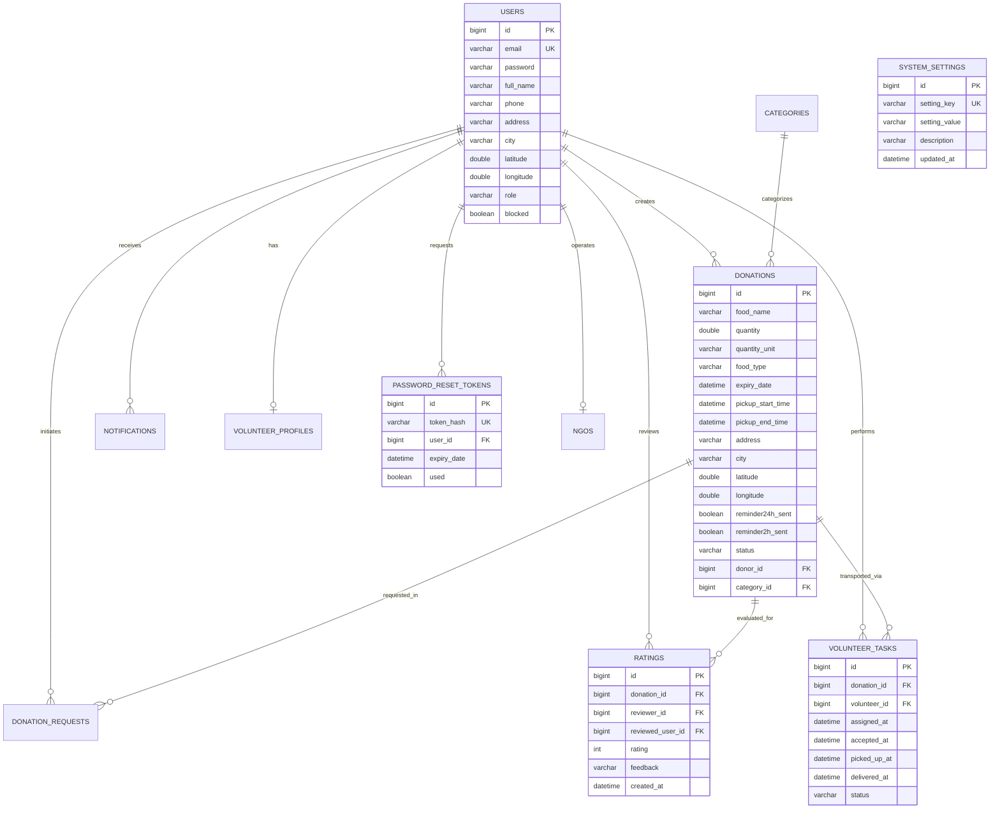

# NourishLink — Food Waste Reduction Platform (Phase 1 & Phase 2)

A comprehensive, production-grade enterprise web application connecting food donors (restaurants, caterers, supermarkets, bakeries) with verified NGOs and volunteer logistics networks to eliminate food waste and nourish local communities.

Built with **React.js + Java 21 + Spring Boot 3.3.4 + Spring Security + JWT + MySQL 8 + Leaflet / OpenStreetMap + Recharts + Spring WebSocket STOMP + Spring Mail + OpenPDF**.

---

## 1. Executive Summary & Architecture

NourishLink operates on a multi-tier distributed architecture ensuring low latency, geospatial discovery, real-time reactive alerting, and audit-grade reporting.

```
                               ┌─────────────────────────────────────────────────────────────┐
                               │                    React.js Frontend (Vite)                 │
                               │  - Leaflet + OpenStreetMap (Discovery & Radial Filter)      │
                               │  - Recharts (Admin, Donor, NGO Dynamic Analytics)           │
                               │  - SockJS + STOMP Client (Real-time Notification Bell)      │
                               │  - Volunteer Portal & Logistics Coordination                │
                               │  - Report Downloader (PDF / CSV)                            │
                               └──────────────┬───────────────────────────────▲──────────────┘
                                              │ HTTP / REST                   │ STOMP / WS
                                              │ (JWT Bearer Auth)             │ (/ws)
                                              ▼                               │
┌─────────────────────────────────────────────────────────────────────────────┴──────────────┐
│                                 Spring Boot 3.3.4 Backend (Java 21)                         │
│                                                                                             │
│  ┌────────────────────────┐  ┌────────────────────────┐  ┌───────────────────────────────┐ │
│  │   Security & Auth      │  │  Geospatial Engine     │  │   Real-Time STOMP Hub         │ │
│  │   - JJWT (0.12.6)      │  │  - Haversine DB Query  │  │   - Channel Interceptor Auth  │ │
│  │   - BCrypt at Rest     │  │  - Radial Bounding     │  │   - Private User Destinations │ │
│  │   - SHA-256 Token Hash │  │  - Zero in-memory scan │  │   - SimpMessagingTemplate     │ │
│  └────────────────────────┘  └────────────────────────┘  └───────────────────────────────┘ │
│                                                                                             │
│  ┌────────────────────────┐  ┌────────────────────────┐  ┌───────────────────────────────┐ │
│  │   Automated Expiry     │  │  Impact Conversion     │  │   Reporting Engine            │ │
│  │   - @Scheduled worker  │  │  - system_settings DB  │  │   - OpenPDF Landscape Reports │ │
│  │   - 24h & 2h reminders │  │  - Dynamic meal ratio  │  │   - Apache Commons CSV        │ │
│  │   - Duplicate-free     │  │  - Landfill diversion  │  │   - Role-Based Access Guards  │ │
│  └────────────────────────┘  └────────────────────────┘  └───────────────────────────────┘ │
└─────────────────────────────────────────────┬───────────────────────────────────────────────┘
                                              │ Spring Data JPA / Hibernate
                                              ▼
┌─────────────────────────────────────────────────────────────────────────────────────────────┐
│                                       MySQL 8 Database                                      │
│  - users                    - ngos                     - categories                         │
│  - donations                - donation_requests        - notifications                      │
│  - ratings                  - volunteer_tasks          - volunteer_profiles                 │
│  - system_settings          - password_reset_tokens                                         │
└─────────────────────────────────────────────────────────────────────────────────────────────┘
```

---

## 2. Phase 2 Advanced Features

### 1. Location-Based Food Discovery & Interactive Map
* **OpenStreetMap + Leaflet**: Fully independent of proprietary APIs (Zero Google Maps dependencies).
* **Database-Side Haversine Distance**: Native SQL spherical distance calculation directly inside MySQL `donations` queries.
* **Configurable Radial Search**: NGOs select radius (1 KM, 5 KM, 10 KM, 25 KM, 50 KM).
* **Browser Geolocation & Manual Coordinate Fallback**: Detects GPS automatically; provides city and coordinate inputs if permission is denied.
* **Interactive Markers**: Custom styled SVG pins with rich popups (Food Name, Quantity, Expiry, Distance in KM, Pickup Address, and Request button).

### 2. Real-Time WebSocket & STOMP Notifications
* **Spring WebSocket STOMP Endpoint**: `/ws` with SockJS fallback.
* **Private User Queues**: Secure `/user/queue/notifications` messaging protected with JWT authentication in channel interceptors.
* **Live Notification Bell**: Real-time counter badge with dynamic dropdown preview and instant toast alerts on arrival.
* **Dedicated Notification Center (`/notifications`)**: Filter unread, mark individual as read, mark all read, delete notifications, and quick jump to donation records.

### 3. Email Notification System & Password Reset
* **Spring Mail Integration**: HTML formatted emails with platform branding, action buttons, and responsive layout.
* **Event Notifications**: Registration welcome, NGO approval/rejection, donation requests, accepted/rejected alerts, pickup reminders, and completion confirmations.
* **Secure Password Reset**: Secure token lifecycle (`password_reset_tokens`) with expiry enforcement and SHA-256 token hashing at rest.

### 4. Automatic Food Expiry & Advance Reminders
* **Background Scheduler (`@Scheduled`)**: Runs continuously to transition overdue `AVAILABLE` donations to `EXPIRED`.
* **Conflict Resolution**: Automatically marks pending requests for expired donations as `REJECTED` and notifies parties.
* **Deduplicated Expiry Reminders**: Dispatches single-delivery reminders at 24 hours and 2 hours before expiry.

### 5. Food Impact Calculation Engine
* **Configurable Conversion Metrics**: Managed via `system_settings` table (`FOOD_TO_MEAL_RATIO`, default 2.0 meals per 1 KG).
* **Impact Cards**: Displayed across Donor, NGO, and Admin workspaces (Food Rescued KG, Community Meals Provided, Pickups Completed).

### 6. Dynamic Analytics Dashboards (Recharts)
* **100% Live Backend Data**: Zero hardcoded mock metrics.
* **Admin Analytics (`/admin/analytics`)**: Monthly Donations, Rescued KG Trend, Status Breakdown, Category Distribution, City-wise Activity.
* **Donor Analytics (`/donor/analytics`)**: Personal monthly donations, rescued weight, status breakdown, category distribution.
* **NGO Analytics (`/ngo/analytics`)**: Claim velocity, monthly pickups, completed distributions, and meals distributed.

### 7. PDF & CSV Report Generation
* **OpenPDF Engine**: High-resolution, professional PDF reports for donation activity and executive monthly impact summaries.
* **Apache Commons CSV**: Streamed CSV data export.
* **Role-Based Access**: Donors and NGOs only access their permitted records; Admins access platform-wide audit data.

### 8. Rating and Feedback System
* **Post-Completion Reviews**: Allowed strictly after a donation is marked `COMPLETED`.
* **Two-Way Mutual Rating**: Donor rates NGO; NGO rates Donor (1 to 5 stars + optional written feedback).
* **Constraints**: Strictly one review per participant per donation; server-side involvement validation.

### 9. Volunteer Logistics Module
* **New Role (`ROLE_VOLUNTEER`)**: Dedicated volunteer registration, profile, and navigation workspace.
* **Volunteer Pickup Tasks (`volunteer_tasks`)**: Automatic task creation on accepted donation requests.
* **Lifecycle Workflow**: `AVAILABLE` &rarr; `ACCEPTED` &rarr; `PICKED_UP` &rarr; `DELIVERED`.
* **Volunteer Portal**: Task discovery map, nearby available tasks, active deliveries, and vehicle management (`BIKE`, `CAR`, `VAN`, `OTHER`).

### 10. Advanced Search & Filtering
* **Backend Pagination & Multi-Criteria Search (`/api/donations/search`)**: Keyword, category, food type (`VEG`, `NON_VEG`, `VEGAN`), city, quantity range, radius, and sorting.

---

## 3. Database ER Diagram



---

## 4. API Endpoints Reference

### Authentication & Account
| Method | Endpoint | Access | Description |
|---|---|---|---|
| `POST` | `/api/auth/register` | Public | Register Donor, NGO, or Volunteer |
| `POST` | `/api/auth/login` | Public | Authenticate user & receive JWT token |
| `GET` | `/api/auth/me` | Authenticated | Retrieve current user profile |
| `POST` | `/api/auth/forgot-password` | Public | Request password reset token email |
| `POST` | `/api/auth/reset-password` | Public | Set new password with secure reset token |

### Location & Donation Discovery
| Method | Endpoint | Access | Description |
|---|---|---|---|
| `GET` | `/api/donations/nearby` | Authenticated | Haversine SQL radius search (lat, lng, radius) |
| `GET` | `/api/donations/search` | Authenticated | Multi-parameter search, filter & pagination |
| `GET` | `/api/donations/available` | Authenticated | Get currently active, non-expired donations |
| `GET` | `/api/donations/{id}` | Public / Auth | Get comprehensive donation details |
| `POST` | `/api/donations` | `ROLE_DONOR` | Create a new food donation listing |
| `PUT` | `/api/donations/{id}` | `ROLE_DONOR` | Update existing donation listing |
| `DELETE` | `/api/donations/{id}` | Donor / Admin | Remove donation listing |

### Volunteer Logistics
| Method | Endpoint | Access | Description |
|---|---|---|---|
| `POST` | `/api/volunteers/register` | Public | Register volunteer with vehicle specifications |
| `GET` | `/api/volunteers/profile` | `ROLE_VOLUNTEER` | Get volunteer profile & vehicle details |
| `PUT` | `/api/volunteers/profile` | `ROLE_VOLUNTEER` | Update volunteer vehicle & availability |
| `GET` | `/api/volunteer/tasks` | `ROLE_VOLUNTEER` | List assigned tasks filtered by status |
| `GET` | `/api/volunteer/tasks/nearby` | `ROLE_VOLUNTEER` | Get unassigned tasks within radius |
| `POST` | `/api/volunteer/tasks/{id}/accept` | `ROLE_VOLUNTEER` | Claim and accept a delivery task |
| `PUT` | `/api/volunteer/tasks/{id}/pickup` | `ROLE_VOLUNTEER` | Mark food collected from donor |
| `PUT` | `/api/volunteer/tasks/{id}/deliver` | `ROLE_VOLUNTEER` | Mark food delivered to NGO |
| `GET` | `/api/volunteer/tasks/stats` | `ROLE_VOLUNTEER` | Retrieve volunteer operational metrics |

### Real-Time Notifications
| Method / Protocol | Endpoint | Access | Description |
|---|---|---|---|
| `WS / STOMP` | `/ws` | Authenticated | WebSocket handshake & STOMP connect |
| `STOMP Queue` | `/user/queue/notifications` | User Private | Real-time push notification destination |
| `GET` | `/api/notifications` | Authenticated | Paginated user notifications |
| `GET` | `/api/notifications/unread-count` | Authenticated | Get unread notification badge count |
| `PUT` | `/api/notifications/{id}/read` | Authenticated | Mark individual notification as read |
| `PUT` | `/api/notifications/read-all` | Authenticated | Mark all user notifications as read |
| `DELETE` | `/api/notifications/{id}` | Authenticated | Delete notification record |

### Analytics & Impact
| Method | Endpoint | Access | Description |
|---|---|---|---|
| `GET` | `/api/analytics/admin` | `ROLE_ADMIN` | Platform-wide monthly metrics & distributions |
| `GET` | `/api/analytics/donor` | `ROLE_DONOR` | Donor impact, rescued KG, and monthly volume |
| `GET` | `/api/analytics/ngo` | `ROLE_NGO` | NGO claim velocity & distributed meal impact |

### Reports & Export
| Method | Endpoint | Access | Description |
|---|---|---|---|
| `GET` | `/api/reports/donations/csv` | Permitted Roles | Export donations ledger as CSV |
| `GET` | `/api/reports/donations/pdf` | Permitted Roles | Export donations ledger as PDF |
| `GET` | `/api/reports/impact/pdf` | `ROLE_ADMIN` | Executive monthly impact report as PDF |

### Rating & Reviews
| Method | Endpoint | Access | Description |
|---|---|---|---|
| `POST` | `/api/ratings` | Completed Parties | Submit 1–5 star rating and feedback |
| `GET` | `/api/ratings/donation/{donationId}` | Authenticated | Get ratings submitted for a donation |
| `GET` | `/api/ratings/user/{userId}` | Authenticated | Get reviews received by a user/organization |
| `GET` | `/api/ratings/user/{userId}/summary`| Authenticated | Get average rating & review count summary |

### System Settings (Admin)
| Method | Endpoint | Access | Description |
|---|---|---|---|
| `GET` | `/api/admin/settings` | `ROLE_ADMIN` | Retrieve all platform configurable keys |
| `PUT` | `/api/admin/settings/{key}` | `ROLE_ADMIN` | Update configuration value & multiplier |

---

## 5. Environment Variables & Configuration

Create a `.env` file or configure system environment variables before launching:

```properties
# MySQL Database Configuration
DB_HOST=localhost
DB_PORT=3306
DB_NAME=food_waste_reduction
DB_USERNAME=root
DB_PASSWORD=your_mysql_password

# JWT Security
JWT_SECRET=404E635266556A586E3272357538782F413F4428472B4B6250645367566B5970
JWT_EXPIRATION_MS=86400000

# Spring Mail (SMTP)
MAIL_HOST=smtp.gmail.com
MAIL_PORT=587
MAIL_USERNAME=your_email@gmail.com
MAIL_PASSWORD=your_app_specific_password

# Frontend URL
FRONTEND_URL=http://localhost:3000
```

---

## 6. Local Setup & Execution

### Prerequisites
* Java 21 LTS installed
* Node.js 18+ and npm installed
* MySQL 8+ server running

### 1. Database Initialization
```sql
CREATE DATABASE IF NOT EXISTS food_waste_reduction;
```

### 2. Backend Startup
```powershell
cd backend
.\mvnw.cmd spring-boot:run
```
* Backend runs on: `http://localhost:8080`
* Swagger UI: `http://localhost:8080/swagger-ui/index.html`
* WebSocket STOMP endpoint: `http://localhost:8080/ws`

### 3. Frontend Startup
```powershell
cd frontend
npm install
npm run dev
```
* Frontend runs on: `http://localhost:3000`

---

## 7. Demo Accounts (Seeded via DataInitializer)

| Role | Email | Password | Coordinates | Notes |
|---|---|---|---|---|
| **Admin** | `admin@foodwaste.org` | `admin123` | Chennai, TN | Platform supervisor, reports, settings |
| **Food Donor** | `donor@demo.com` | `donor123` | 13.0827, 80.2707 | Restaurant / food establishment |
| **Verified NGO** | `ngo@demo.com` | `ngo123` | 13.0604, 80.2496 | Approved charitable relief organization |
| **Volunteer** | `volunteer@demo.com` | `volunteer123` | 13.0827, 80.2707 | Two-wheeler pickup & delivery hero |

---

## 8. Automated Test Suite

Run the full backend test suite covering Haversine distance, scheduled expiry deduplication, rating validation, volunteer workflow, and notification dispatch:

```powershell
cd backend
.\mvnw.cmd test
```
* **Result**: `Tests run: 34, Failures: 0, Errors: 0, Skipped: 0` (BUILD SUCCESS).
